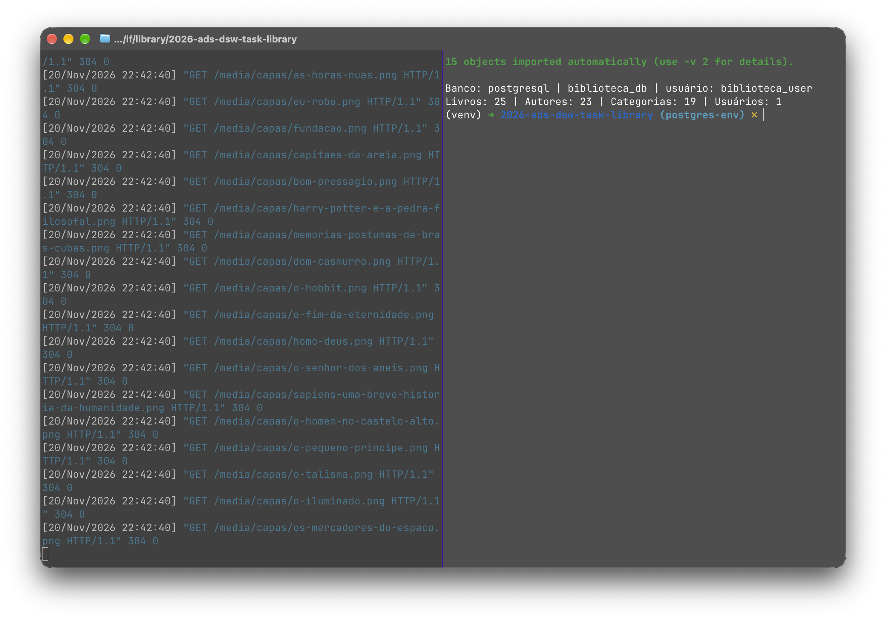
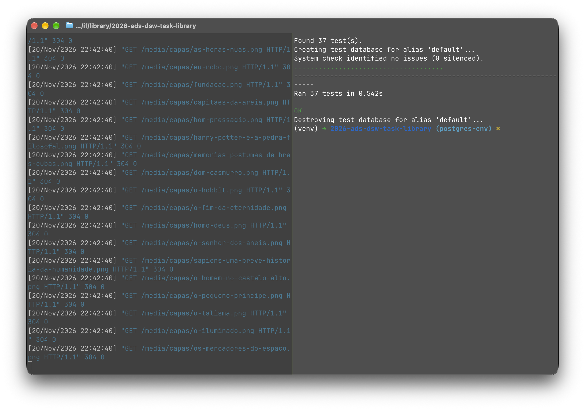
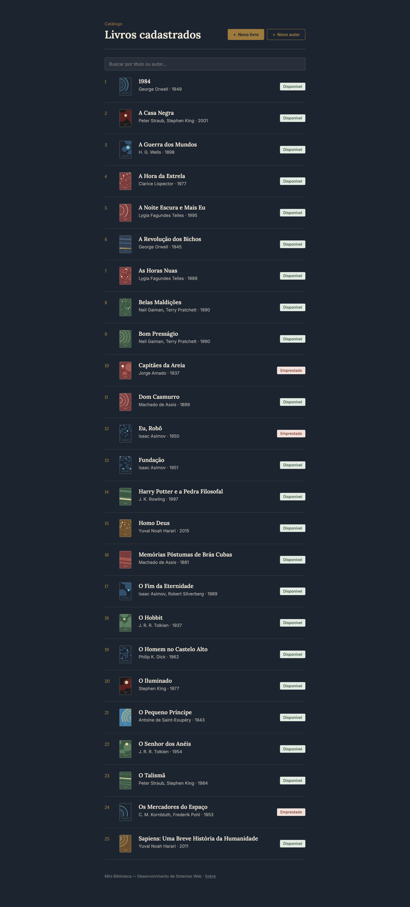
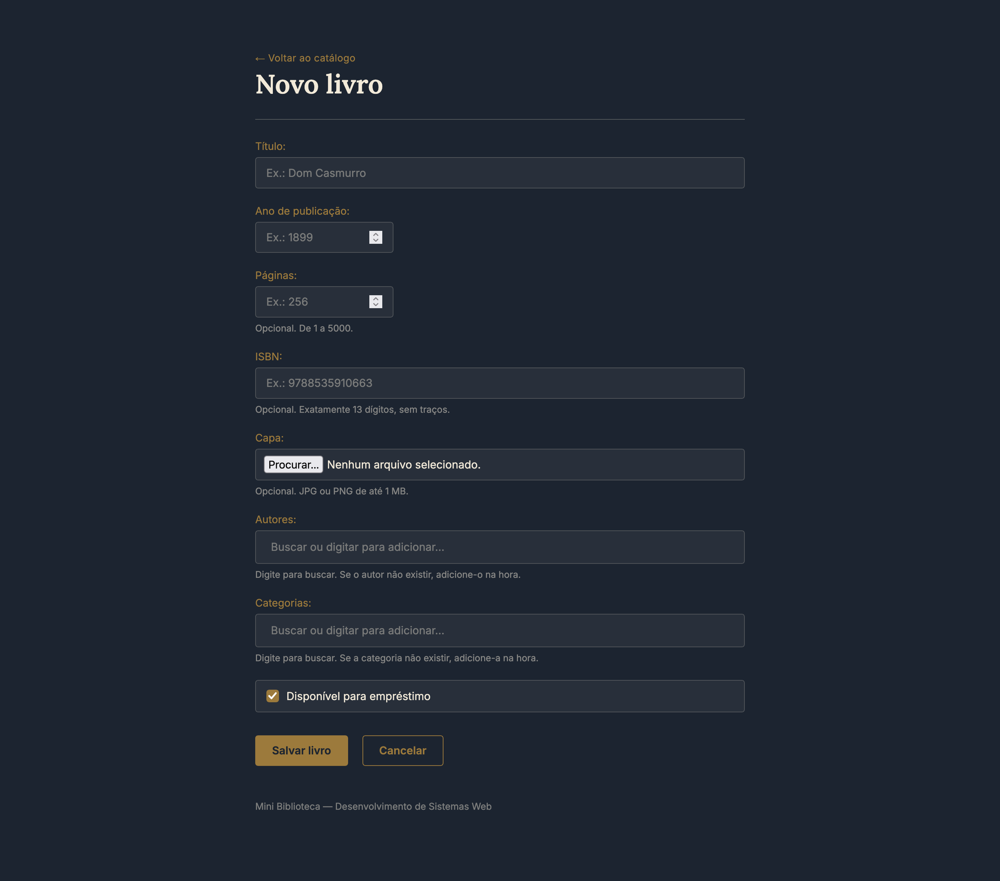
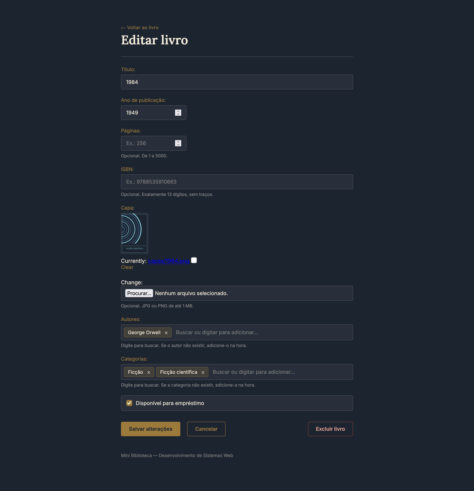
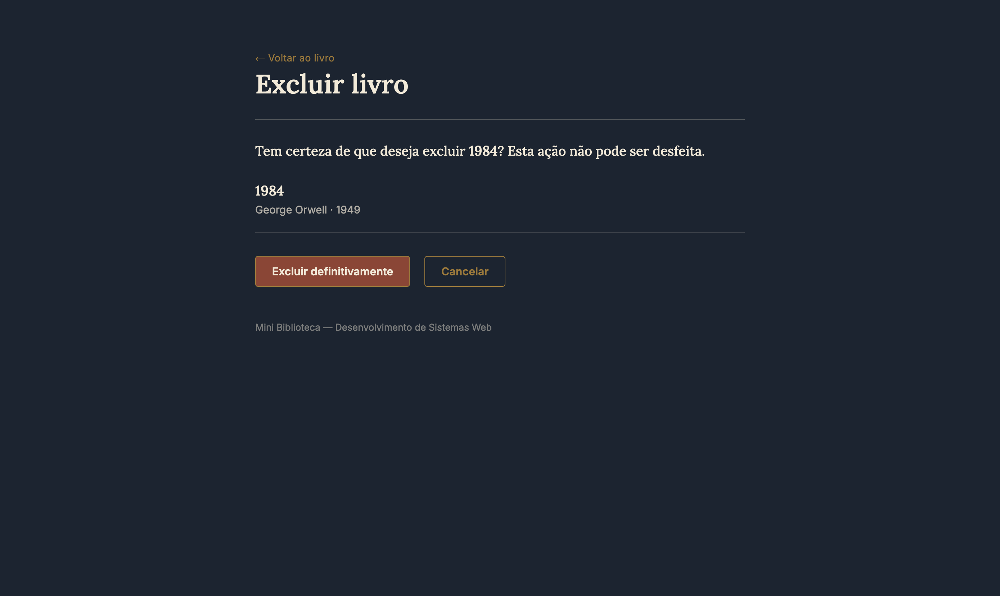
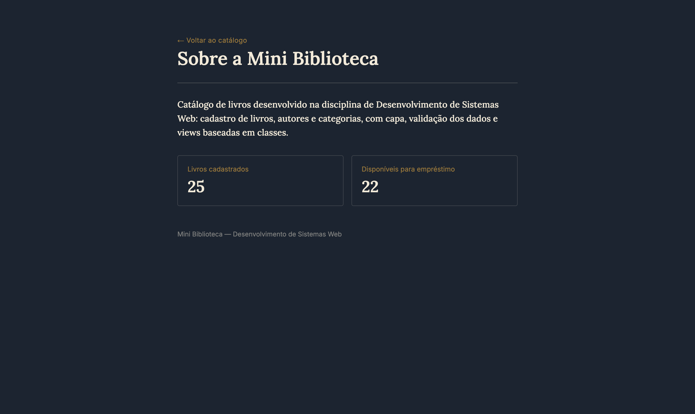
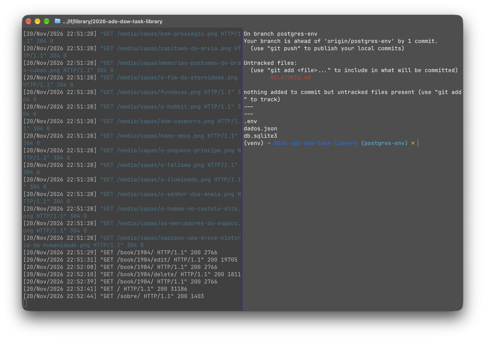

# Relatório: Django com PostgreSQL e variáveis de ambiente

**Aluno:** Tallys Cesar Gurgel Batista
**Disciplina:** Desenvolvimento de Sistemas Web (ADS, IFRN, Campus Pau dos Ferros)
**Projeto:** Mini Biblioteca
**Data:** 20/11/2026

O projeto saiu do SQLite para o PostgreSQL, e todas as credenciais agora vêm de variáveis de ambiente lidas de um arquivo `.env`, que não vai para o repositório.

## Sumário

1. [SQLite × PostgreSQL](#1-sqlite--postgresql)
2. [Driver: psycopg](#2-driver-psycopg)
3. [Chaves do DATABASES](#3-chaves-do-databases)
4. [Banco e usuário próprios](#4-banco-e-usuário-próprios)
5. [Variáveis de ambiente](#5-variáveis-de-ambiente)
6. [Lendo o .env com python-decouple](#6-lendo-o-env-com-python-decouple)
7. [.gitignore e .env.example](#7-gitignore-e-envexample)
8. [Outras configurações que saem do settings.py](#8-outras-configurações-que-saem-do-settingspy)
9. [Prática: settings.py antes e depois](#9-prática-settingspy-antes-e-depois)
10. [Prática: passo a passo executado](#10-prática-passo-a-passo-executado)
11. [Prints do sistema sobre o PostgreSQL](#11-prints-do-sistema-sobre-o-postgresql)
12. [Fontes e repositório](#12-fontes-e-repositório)

---

## Pesquisa

### 1. SQLite × PostgreSQL

O SQLite é uma biblioteca que guarda o banco inteiro num único arquivo. Já o PostgreSQL é um servidor separado, ao qual a aplicação se conecta pela rede. A própria documentação do SQLite diz que ele não compete com servidores como o PostgreSQL: ele foi feito para resolver outro tipo de problema, em que simplicidade de instalação e manutenção importa mais.

| Aspecto | SQLite | PostgreSQL |
| --- | --- | --- |
| Arquitetura | Biblioteca embutida no programa; o banco é 1 arquivo (`db.sqlite3`) | Cliente/servidor, com processo próprio |
| Instalação | Nenhuma: já vem com o Python | Instalar e manter o servidor |
| Usuários e permissões | Não tem; quem acessa o arquivo acessa tudo | Papéis (roles), senhas e permissões por banco e tabela |
| Escritas simultâneas | Uma escrita por vez no arquivo inteiro | Muitas conexões escrevendo ao mesmo tempo |
| Tipos e recursos | Tipagem flexível, recursos básicos | Tipos ricos (JSONB, arrays, datas com fuso), busca textual, extensões |
| Uso típico | Desenvolvimento, testes, apps locais, sites de pouco acesso | Produção, sistemas com vários usuários, dados importantes |

Na Mini biblioteca, o SQLite serviu bem durante o desenvolvimento. Para colocar o sistema no ar com vários usuários, o PostgreSQL é a escolha certa, e também é o banco com mais recursos suportados pelo Django.

### 2. Driver: psycopg

O Django não conversa com o PostgreSQL sozinho: ele usa o backend `django.db.backends.postgresql`, que depende do driver **psycopg**, a biblioteca Python que implementa o protocolo do PostgreSQL. As versões atuais do Django aceitam o psycopg 3 (pacote `psycopg`) e o antigo psycopg2. Usei o psycopg 3, que é o recomendado hoje.

A forma mais simples de instalar é o pacote binário, que já traz as bibliotecas de C necessárias, sem precisar compilar nada:

```bash
pip install "psycopg[binary]"
pip freeze > requirements.txt
```

O pacote no PyPI se chama `psycopg`, e não `psycopg3`. Versão usada no projeto: psycopg 3.3.9.

### 3. Chaves do DATABASES

O dicionário `DATABASES['default']` diz ao Django qual banco usar e como se conectar a ele.

| Chave | O que significa | Valor no projeto |
| --- | --- | --- |
| `ENGINE` | Backend do Django, ou seja, qual tipo de banco | `django.db.backends.postgresql` (fixo no código) |
| `NAME` | Nome do banco dentro do servidor (no SQLite, era o caminho do arquivo) | `DB_NAME` do `.env` |
| `USER` | Usuário (role) do PostgreSQL usado na conexão | `DB_USER` do `.env` |
| `PASSWORD` | Senha desse usuário | `DB_PASSWORD` do `.env` |
| `HOST` | Endereço do servidor (`localhost` na máquina local; IP ou nome em produção) | `DB_HOST` do `.env` |
| `PORT` | Porta TCP do servidor; o padrão do PostgreSQL é 5432 | `DB_PORT` do `.env` |

O `ENGINE` pode ficar escrito no código porque não é segredo: ele só diz que o projeto usa PostgreSQL. Todo o resto muda de uma máquina para outra ou é sensível.

### 4. Banco e usuário próprios

A aplicação não deve se conectar com o superusuário, porque ele pode apagar qualquer banco do servidor. Se a senha vazar, o estrago fica limitado ao banco da biblioteca. Por isso, criei um papel (role) com login e senha e um banco que pertence a ele:

```sql
CREATE ROLE biblioteca_user WITH LOGIN PASSWORD 'uma-senha-forte' CREATEDB;
CREATE DATABASE biblioteca_db OWNER biblioteca_user ENCODING 'UTF8';
```

- `LOGIN` permite que o papel se conecte. `CREATE USER` é o mesmo que `CREATE ROLE ... LOGIN`.
- `OWNER` torna o usuário dono do banco, então ele pode criar as tabelas das migrações.
- `CREATEDB` só é necessário porque o `manage.py test` cria e apaga um banco temporário (`test_biblioteca_db`). Sem isso, os testes falham com "permission denied to create database".
- `UTF8` é a codificação que o Django espera.

Os comandos acima rodam no `psql` conectado como superusuário, só nessa vez. Usei o **Postgres.app** (PostgreSQL 18.6) no macOS. Nele, o superusuário é o próprio usuário do Mac, e não `postgres`, então o acesso é `psql postgres`. No Linux, seria `sudo -u postgres psql`. A partir daí, a aplicação só usa o `biblioteca_user`, e a conexão dele pode ser testada com:

```bash
psql -h localhost -U biblioteca_user -d biblioteca_db -c "select current_user, current_database();"
```

### 5. Variáveis de ambiente

Variáveis de ambiente são pares `NOME=valor` que o sistema operacional entrega a cada processo quando ele começa a rodar. Exemplos são `PATH` e `HOME`. No Python, elas ficam em `os.environ`. Elas permitem que o mesmo código rode em máquinas diferentes, cada uma com a sua configuração, sem editar nenhum arquivo do projeto.

Não se escreve senha no código por três motivos:

- **O código se espalha.** Ele vai para o GitHub, para os colegas e para backups. Uma senha commitada fica no histórico do Git mesmo depois de apagada do arquivo, e existem robôs que varrem repositórios públicos atrás de credenciais.
- **Cada ambiente tem a sua senha.** Desenvolvimento, testes e produção usam bancos e credenciais diferentes. Com variáveis de ambiente, só o ambiente muda, e o código continua igual.
- **Trocar a senha fica fácil.** Quando uma senha vaza, basta mudar a variável, sem novo commit nem deploy de código.

A documentação do Django recomenda proteger a senha do banco da mesma forma que a `SECRET_KEY`, sem escrevê-la no código.

### 6. Lendo o .env com python-decouple

Escolhi o **python-decouple** porque ele tem uma única função, `config()`, e já converte os tipos. Ele procura cada valor nesta ordem: (1) variável de ambiente de verdade, (2) arquivo `.env` (ou `settings.ini`) na raiz do projeto, (3) o `default` passado no código. Se não achar o valor nem houver `default`, ele para com `UndefinedValueError`, o que é melhor do que o sistema subir com uma configuração errada.

```bash
pip install python-decouple
```

```python
from decouple import Csv, config

SECRET_KEY = config('SECRET_KEY')                                # obrigatória
DEBUG = config('DEBUG', default=False, cast=bool)                # 'True'/'False' -> bool
ALLOWED_HOSTS = config('ALLOWED_HOSTS', default='', cast=Csv())  # 'a,b' -> ['a', 'b']
```

O `cast` é importante. Toda variável de ambiente é texto, e a string `'False'` não vazia seria considerada verdadeira pelo Python. Com `cast=bool`, ela vira o booleano `False` de verdade.

As alternativas funcionam de forma parecida: o **python-dotenv** só carrega o `.env` para dentro do `os.environ`, e o **django-environ** também lê uma URL de banco, como `DATABASE_URL=postgres://...`.

### 7. .gitignore e .env.example

- O **`.gitignore`** lista os arquivos que o Git não deve versionar. No projeto, ele ignora o `.env` (as senhas reais), o `db.sqlite3` (banco antigo com dados locais), o `dados.json` (exportação dos dados), `media/` (arquivos enviados pelos usuários), `venv/` e `__pycache__/`. Um arquivo que já foi commitado antes continua sendo rastreado mesmo depois de entrar no `.gitignore`. Nesse caso é preciso removê-lo do índice com `git rm --cached db.sqlite3`.
- O **`.env.example`** é um modelo do `.env` com valores fictícios, e esse vai para o repositório. Ele documenta quais variáveis o projeto precisa. Quem clona o projeto faz `cp .env.example .env`, preenche os valores reais e roda.

```dotenv
# .env.example
SECRET_KEY=troque-por-uma-chave-gerada
DEBUG=True
ALLOWED_HOSTS=localhost,127.0.0.1

DB_NAME=biblioteca_db
DB_USER=biblioteca_user
DB_PASSWORD=sua-senha-aqui
DB_HOST=localhost
DB_PORT=5432
```

### 8. Outras configurações que saem do settings.py

| Configuração | Por que sai do código |
| --- | --- |
| `SECRET_KEY` | Assina sessões, cookies, tokens de CSRF e links de redefinição de senha. Quem tem a chave consegue forjar esses dados. O Django recomenda ler a chave de uma variável de ambiente e nunca commitá-la. |
| `DEBUG` | Com `True` em produção, as páginas de erro mostram trechos do código, variáveis locais e configurações. O valor deve ser `True` só no desenvolvimento. |
| `ALLOWED_HOSTS` | Os domínios aceitos mudam de ambiente para ambiente. Com `DEBUG=False`, o Django recusa tudo se essa lista estiver vazia. |
| Credenciais de serviços externos | Senha de e-mail (`EMAIL_HOST_PASSWORD`), chaves de API, armazenamento em nuvem: são segredos como a senha do banco. |

Como a `SECRET_KEY` antiga do projeto já estava no histórico do Git, gerei uma chave nova para o `.env` em vez de copiar a antiga:

```bash
python -c "from django.core.management.utils import get_random_secret_key; print(get_random_secret_key())"
```

---

## Prática

### 9. Prática: settings.py antes e depois

Arquivo: `config/settings/base.py`. A chave antiga aparece cortada de propósito, porque ela já estava exposta no histórico do Git e foi substituída por uma nova, que fica só no `.env`.

**Antes** (SQLite e segredos escritos no código):

```python
from pathlib import Path

# ...

SECRET_KEY = 'django-insecure-=!9x2y#8w3san_...'

# SECURITY WARNING: don't run with debug turned on in production!
DEBUG = True

ALLOWED_HOSTS = []

# ...

DATABASES = {
    'default': {
        'ENGINE': 'django.db.backends.sqlite3',
        'NAME': BASE_DIR / 'db.sqlite3',
    }
}
```

**Depois** (PostgreSQL, sem nenhum valor sensível no código):

```python
from pathlib import Path

from decouple import Csv, config

# ...

SECRET_KEY = config('SECRET_KEY')

# SECURITY WARNING: don't run with debug turned on in production!
DEBUG = config('DEBUG', default=False, cast=bool)

ALLOWED_HOSTS = config('ALLOWED_HOSTS', default='', cast=Csv())

# ...

DATABASES = {
    'default': {
        'ENGINE': 'django.db.backends.postgresql',
        'NAME': config('DB_NAME'),
        'USER': config('DB_USER'),
        'PASSWORD': config('DB_PASSWORD'),
        'HOST': config('DB_HOST'),
        'PORT': config('DB_PORT'),
    }
}
```

As cinco credenciais do banco não têm `default`: se alguma faltar, o Django não sobe e diz qual está faltando, por exemplo `UndefinedValueError: DB_PASSWORD not found`. O `DEBUG` tem `default=False` de propósito, para que esquecer a variável nunca deixe o modo de depuração ligado.

### 10. Prática: passo a passo executado

A ordem importa: os dados são exportados **enquanto o projeto ainda aponta para o SQLite**, antes de trocar o `settings.py`.

1. **Criar uma branch para a tarefa:** `git switch -c postgres-env`.
2. **Exportar os dados do SQLite.** As tabelas que o `migrate` recria sozinho ficam de fora (contenttypes, permissões, sessões e log do admin), e as chaves naturais evitam conflito de IDs:

    ```bash
    python manage.py dumpdata --natural-foreign --natural-primary \
      -e contenttypes -e auth.Permission -e admin.logentry -e sessions \
      --indent 2 -o dados.json
    ```

    Foram exportados **25 livros, 23 autores, 19 categorias e 1 usuário**.
3. **Conferir o servidor:** o PostgreSQL 18.6 já estava instalado pelo Postgres.app. O `pg_isready` respondeu `accepting connections`.
4. **Criar o usuário e o banco** (seção 4), no `psql postgres`.
5. **Instalar as dependências** (psycopg 3.3.9 e python-decouple 3.8) e atualizar o `requirements.txt`:

    ```bash
    pip install "psycopg[binary]" python-decouple
    pip freeze > requirements.txt
    ```

6. **Criar o `.env`** a partir do `.env.example`, com a senha real e uma `SECRET_KEY` nova. Atualizar o `.gitignore` e conferir com `git check-ignore .env dados.json db.sqlite3`.
7. **Trocar o `settings.py`** para a versão "depois" da seção 9.
8. **Criar as tabelas no PostgreSQL e importar os dados:**

    ```bash
    python manage.py migrate
    python manage.py loaddata dados.json
    ```

    O `loaddata` também ajusta as sequências de IDs do PostgreSQL. Por isso, o próximo livro cadastrado recebe o ID seguinte ao último importado, sem erro de chave duplicada.
9. **Conferir.** A contagem no PostgreSQL deve repetir 25 / 23 / 19 / 1. Depois, `python manage.py test apps.library` (37 testes OK) e um teste manual no navegador: cadastro, listagem, edição, exclusão e `/sobre/`.

O `dados.json` contém os hashes de senha dos usuários do admin, então também entrou no `.gitignore` e não vai para o repositório. As capas em `media/` não mudam: o banco guarda só o caminho de cada arquivo, e os arquivos continuam na mesma pasta.

### 11. Prints do sistema sobre o PostgreSQL

> Os prints ficam em `docs/prints/`. Salve cada imagem com o nome indicado.

**Banco em uso e dados importados**

```bash
python manage.py shell -c "from django.db import connection; print(connection.vendor, connection.settings_dict['NAME'])"
# saída: postgresql biblioteca_db
```



**Testes passando no PostgreSQL**



**Listagem com os livros vindos do SQLite**



**Cadastro de um livro novo, com capa**



**Edição do livro**



**Confirmação de exclusão**



**Página Sobre, com os totais**



**`git status` sem o `.env`**



### 12. Fontes e repositório

**Repositório:** https://github.com/TallysCesarGB/2026-ads-dsw-task-library (branch `postgres-env`). O `.env` real não está no repositório, só o `.env.example`.

**Fontes consultadas:**

- Django: [Databases, PostgreSQL notes](https://docs.djangoproject.com/en/5.2/ref/databases/)
- Django: [Deployment checklist (SECRET_KEY, DEBUG, DATABASES)](https://docs.djangoproject.com/en/5.2/howto/deployment/checklist/)
- PostgreSQL: [CREATE ROLE](https://www.postgresql.org/docs/17/sql-createrole.html)
- Psycopg 3: [Installation](https://www.psycopg.org/psycopg3/docs/basic/install.html)
- SQLite: [Appropriate Uses For SQLite](https://sqlite.org/whentouse.html)
- python-decouple: [Documentação no PyPI](https://pypi.org/project/python-decouple/)